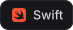
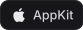
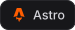
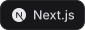
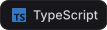

```console
$ whoami
Elior · 18 · French Alps · byelior.dev

$ ls ~/now
drawn-qr/    gresil/      tbd-1.2/     radiance/
```

I design, build and ship software. Native apps mostly, web when it’s the right tool.

I learn by building: every project here started as something I needed and didn’t know how to make yet. Most go from idea to release in under two weeks. I use all of them every day, which is the only test I trust.

I work alone on my own apps, and inside a team on [Radiance](https://github.com/Radiance-Team). The two require completely different things, and I like both.

     

#### Shipped

|  |
| :--- |
|  **[Freepark](https://freeparkapp.fr)** <a href="https://apps.apple.com/fr/app/freepark/id6813134751"></a><br>Find free parking around you, from OpenStreetMap data. |
|  **[To Be Downloaded](https://tbd.yt)** <a href="https://github.com/eliorpom-cmd/to-be-downloaded"></a><br>The macOS YouTube downloader that just works. |
|  **[Radiance Wallpapers](https://app.radiancewallpapers.com)**<br>I reverse-engineered their iOS app to build the webapp. That’s how I joined the team. |
|  **[GRESIL](https://meteo.byelior.com)** <a href="https://github.com/eliorpom-cmd/accurate-meteo"></a><br>The most accurate weather forecast for your city, once you train it there. [Train it for your city](https://github.com/eliorpom-cmd/accurate-meteo#use-it-for-another-city). |
|  **[Macfin](https://github.com/eliorpom-cmd/macfin)** <a href="https://github.com/eliorpom-cmd/macfin"></a><br>A native Mac app for the movies and TV shows on your Jellyfin server. |
|  **[Lumac](https://github.com/eliorpom-cmd/lumac)** <a href="https://github.com/eliorpom-cmd/lumac"></a><br>A menu bar app that puts a MacBook to sleep when its lid is closed with an external display connected. |
|  **[noaislop.xyz](https://noaislop.xyz)** <a href="https://github.com/eliorpom-cmd/noaislop.xyz"></a><br>A page to send to someone who published AI slop. |
|  **[Print on my desk](https://printomatic.byelior.dev)** <a href="https://github.com/eliorpom-cmd/print-on-my-desk"></a><br>A thermal printer on my desk, with a webapp in front of it. Send someone a link and what they write comes out on paper, on my desk. |
|  **[claude-bounce](https://github.com/eliorpom-cmd/claude-bounce)** <a href="https://github.com/eliorpom-cmd/claude-bounce"></a><br>Bounces your editor’s Dock icon when Claude Code finishes a turn. |

#### In progress

|  |
| :--- |
|  **Hand-drawn QR codes**<br>QR codes that look like hand-drawn doodles and still scan. |

#### Also

Websites for small businesses in the Alps, mostly Astro, from the branding to the hosting. Available for one-off projects and long-term work with small teams.

#### Elsewhere

```console
$ contact --list
web        byelior.dev
mail       eliorpom@gmail.com
threads    @mavie.log
```

If something here saved you time, consider supporting me:

[](https://ko-fi.com/Q5W123YHYV)
